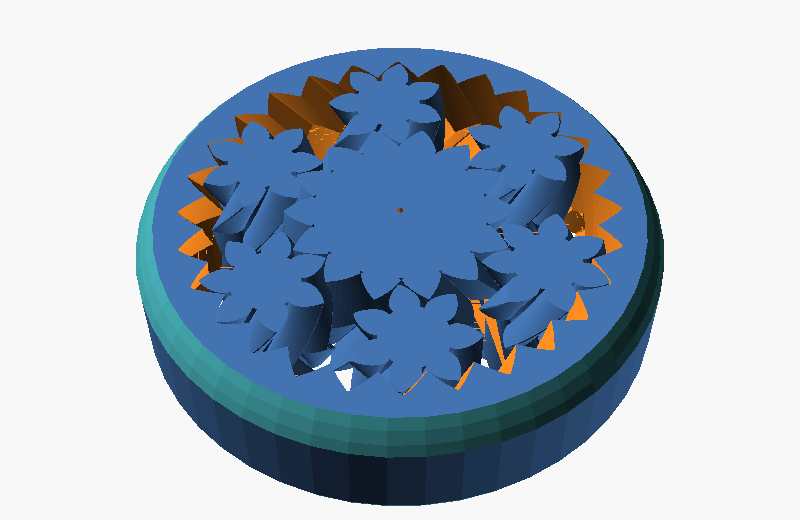

# planetary-gear-fidget

A planetary gear fidget toy in OpenSCAD that prints in place: a sun, a ring and six planets of
herringbone gears, rounded into a 90 mm disc. It comes off the bed already assembled, and turning
the sun turns everything.

## Use it

Open `planetary_gear_fidget.scad` in [OpenSCAD](https://openscad.org) and set the parameters in the
Customizer:

- **Size:** `outerRingDiameter` (90 mm) is the disc's diameter, `gearThickness` (25 mm) its
  thickness.
- **Gears:** `planetGearCount` and `planetGearTeethCount`. `approxSunGearTeethCount` is the sun you
  ask for. The planets only sit evenly round the sun when sun + ring teeth is a multiple of the
  planet count, so the nearest count that is gets used, the smaller on a tie; the console echoes it.
  `pressureAngle` (42°) makes short, strong teeth that print well. `twistTeethCount` sets how far
  each half of a herringbone twists (0 gives spur gears), and `maxToothDepthRatio` the tooth height
  above the pitch circle, in modules. A tooth that would come to a point is cut short of it.
- **Fit:** `clearanceTolerance` (0.15 mm) is the gap where the parts mesh. `hexHoleWidth` cuts a
  hexagonal hole through the sun, for a key or an Allen wrench.
- **Rounding:** the rim is rounded by a torus `outerTorusDiameter` across with a tube
  `torusThickness` thick.

Print it flat, with no supports. If the parts are stuck together off the printer, raise
`clearanceTolerance`; if they rattle, lower it.

## Checks

`just test` takes about 8 s on OpenSCAD 2026.10.15. It renders six layouts, from the default to
3 planets of 9 teeth and a 60 mm disc, with warnings treated as errors, and checks that each one:

- has a sun tooth count that lets the planets sit evenly;
- comes out as `planetGearCount + 2` separate parts, so nothing is joined that has to turn, at
  `outerRingDiameter` across and `gearThickness` tall;
- fuses into one part when the clearance is -0.05 mm. A planet only fuses with the sun and the ring
  when its teeth are in mesh with theirs.

It also checks the two refusals: under 5 planet teeth, and planets that would overlap each other.

## Known limits

- **This version hasn't been printed.** The checks say the parts mesh and clear each other, not how
  it turns off a real printer.
- The top is flat, with only the rim rounded.

The version this replaces didn't render: `torus.scad` read `innerTorusDiameter` and
`torusThickness`, which only existed inside `fidget()`, so OpenSCAD 2026.10.15 warned
`Ignoring unknown variable "innerTorusDiameter"` and exited 1. Its exports in `prints/` were
removed with it.

## Origin and licence

The fidget is a rewrite, under MIT, of an idea from emmett's
[Gear Bearing](https://www.thingiverse.com/thing:53451) on Thingiverse: a print-in-place planetary
set of herringbone gears. Earlier versions of this repository were modified from
[SimonWaldherr/openscad-examples](https://github.com/SimonWaldherr/openscad-examples)'s planetary
gear fidget, which carries that design's code; the Gear Bearing is under CC BY-SA 4.0. Those
versions are in this repository's history. The code here is new, from the standard involute gear
geometry; the parameters keep their names. MIT; see [LICENSE](LICENSE).
